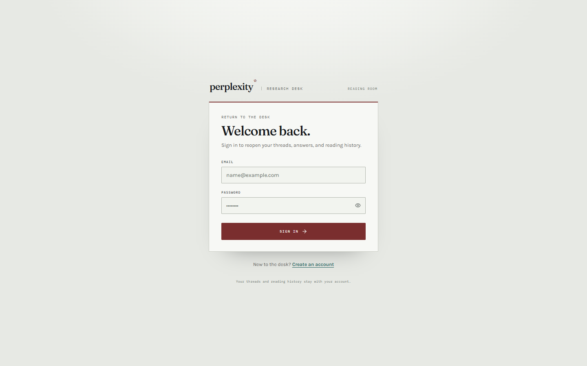
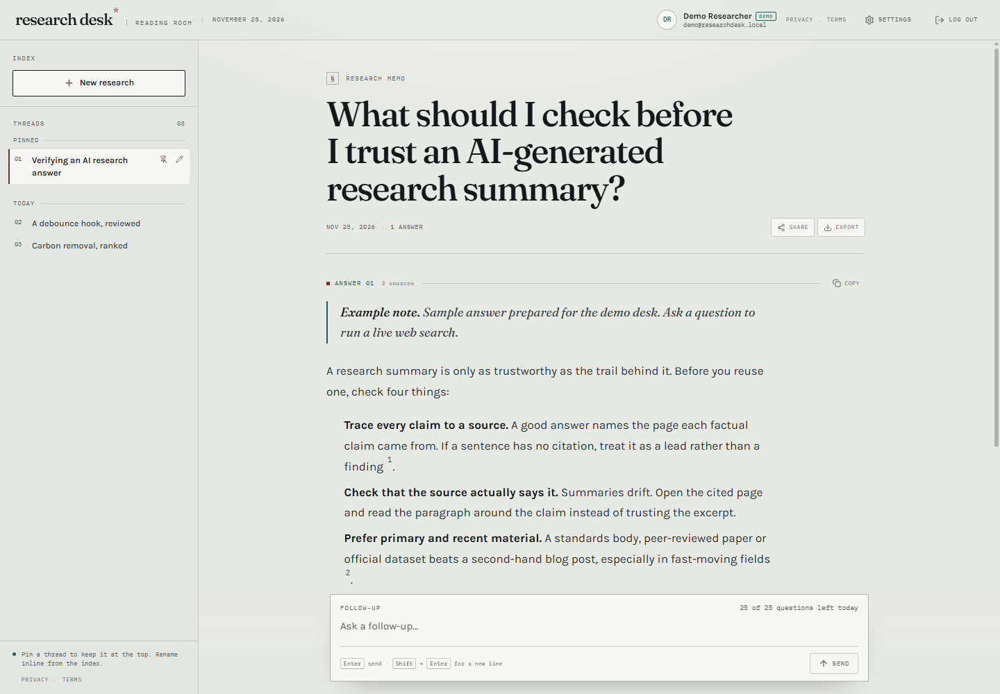
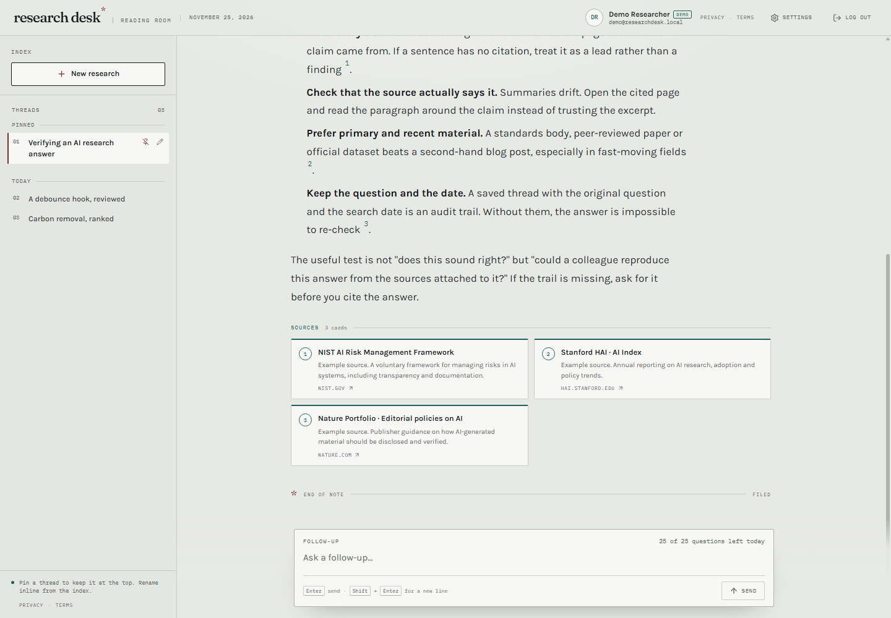

# ResearchDesk

> Answers with the sources still attached.

[](https://researchdesk.furqankhan.dev)
[](https://furqankhan.dev)
[](LICENSE)

ResearchDesk is a research workspace where every answer is stored as a reading note with numbered sources. Ask a question and the API searches the live web with Tavily, reasons over the results with Groq, and files the answer, its citations, and the source cards into a thread you can reopen, organise, export, or share. It is built for researchers, analysts, students, writers, and developers who need to defend or reuse an answer later. Part of [Furqan Khan's portfolio](https://furqankhan.dev).

**Live:** https://researchdesk.furqankhan.dev · **Source:** https://github.com/fk219/research-desk · **Case study:** https://furqankhan.dev

## What it is

Most chat interfaces answer from the model's memory and throw the conversation away. ResearchDesk answers from today's web and keeps the question, the answer, the retrieved pages, and the date together.

The thread is the record. The source list is captured on the server when the search tool runs, not reconstructed from the rendered answer, so a citation such as `[2]` still resolves to the page the model was given. A thread can be renamed, pinned, exported as Markdown, or published as a read-only report.

## The signature idea

Retrieval is not a hidden step. The model runs inside a LangChain agent with one tool, `search_internet`, which wraps Tavily. The model chooses the query. The backend executes it and keeps the returned source cards alongside the streamed answer.

That produces three things that normally get lost:

- The answer text and its numbered citations are stored together.
- The source cards (title, URL, snippet) are stored as structured data on the AI message.
- The original question and the thread remain attached, so the answer can be checked next week rather than only in the moment.

The result is a reading note, not a disposable reply.

## What works

- **Sourced answers.** Each answer stores the sources returned by the search tool, and inline citation markers jump to the matching source card.
- **Streaming responses.** The composer sends `stream: true` and renders server-sent `start`, `chunk`, and `done` events. The non-streaming JSON path also remains in the API.
- **Saved threads.** Server-side history per account, grouped by date in the rail, with inline rename and pin-to-top.
- **Read-only sharing.** A thread can be published at `/share/:shareId`. The public payload contains the title, timestamps, message role, content, sources, and date. It contains no email, user id, chat id, or message id. Sharing is off by default. Turning sharing off keeps the same id, so turning it back on restores the link.
- **Markdown export.** Download the question, answers, and numbered sources with URLs as a portable `.md` file.
- **Real session revocation.** Logout increments the user's `tokenVersion`, invalidating every JWT issued earlier, then clears the cookie. A password change does the same.
- **Account controls.** Change the password (8 to 72 characters), download a JSON export of the account and all threads, or delete the account with its threads, messages, and share links.
- **Demo desk.** One click opens a shared account with three clearly labelled static example threads. No email verification is needed.
- **Private document library.** Upload text or Markdown, index it in the background, search it with hybrid local embeddings + keyword ranking, and let the assistant cite it alongside live web sources. Re-ingest and delete are supported; uploads are scoped to the owner.
- **Abuse limits.** 25 answered questions per user per UTC day, plus per-IP limits on auth, account changes, demo entry, and message sends.
- **Library limits.** Documents are text/Markdown JSON up to 200,000 characters. Embeddings are local hash-256 vectors, and ingestion runs in-process rather than a durable external queue.

## Screens

| Research note | Sourced answer | Source cards |
|---|---|---|
|  |  |  |

## Tech stack in detail

| Layer | Technology | What it does here |
|---|---|---|
| Web app | React 19, Vite 7, Redux Toolkit, React Router 7, Tailwind CSS 4 | Dashboard, thread rail, composer, account pages, and the public report. |
| Answer rendering | react-markdown, lucide-react | Renders answer Markdown, rewrites `[n]` citations into links, and lays out the source cards. |
| API | Node.js 22, Express 5 | REST endpoints for auth, chats, messages, sharing, quota, and account export/deletion. |
| Data | MongoDB, Mongoose 9 | Stores users, threads (`pinned`, `shared`, `shareId`), and messages with structured `sources`. |
| Retrieval | Tavily (`@tavily/core`) | Searches the live web and returns up to five results per tool call. |
| Reasoning | Groq `openai/gpt-oss-120b` via `@langchain/groq` and LangChain `createAgent` | Chooses the search query, reads the results, and streams the answer. Mistral Small is used instead when `GROQ_API_KEY` is absent. |
| Auth and security | JWT httpOnly cookie, bcryptjs, `tokenVersion`, Helmet, express-rate-limit, CORS allowlist | One-day sessions, session revocation, password hashing, security headers, and per-IP limits. |
| Email | Nodemailer with a Gmail app password | Sends the registration verification link. |
| Hosting and CI | Vercel, Render, MongoDB Atlas, GitHub Actions | SPA and API proxy on Vercel; API on Render; database on Atlas; CI runs API tests plus frontend lint and build. |

## Architecture

System diagram, failure behavior, runbook, and decisions are in [docs/architecture.md](docs/architecture.md), [docs/runbook.md](docs/runbook.md), and [docs/adr](docs/adr). The API contract is [docs/openapi.yaml](docs/openapi.yaml).

The browser is a React SPA. Vercel rewrites `/api/*` to the Render API, so the session cookie stays on one origin in production. The API mounts three routers: `/api/auth`, `/api/chats`, and `/api/public`.

A question passes the per-IP message limiter and the daily quota check. If it starts a new thread, the API generates a short title and creates the `Chat`; then it writes the user message before calling the model. The LangChain agent can call `search_internet`. Tavily's results go back to the model, while the server separately collects clean, de-duplicated source cards (up to eight). The stream sends the new chat and user message, then text chunks, then the saved AI message with its sources.

```
Browser (React + Redux)
   |  POST /api/chats/message  (SSE when stream: true)
   v
Express API
   |-- auth cookie -> load user -> compare tokenVersion
   |-- daily quota (25 answered questions / UTC day)
   |-- create or reuse Chat, save the user Message
   v
LangChain agent (Groq, or Mistral when Groq is not configured)
   |  tool call: search_internet(query)
   v
Tavily web search
   |  results + source cards
   v
answer chunks + numbered sources
   |
   v
MongoDB (Chat, Message.sources)
   |
   v
client renders the answer, citation links, and source cards
```

```text
backend/
  server.js
  src/
    app.js                     Express app, CORS, Helmet, rate limits
    config/database.js         MongoDB connection
    routes/                    auth, chat, public share
    controllers/               auth, account, chat
    middleware/                identifyUser, rate limiters
    services/
      ai.services.js           Groq/Mistral agent + source-capturing search tool
      internet.service.js      Tavily adapter
      demo.service.js          shared demo account + idempotent seed
      quota.service.js         daily answered-question quota
      mail.service.js          Nodemailer transport
    models/                    User, Chat, Message
    validator/                 registration and login validation
  test/api.test.js             node:test API suite
frontend/
  src/
    app/                       store, routes, global styles
    features/auth/             login, register, demo entry, guard
    features/account/          password, export, deletion
    features/chat/             dashboard, rail, composer, answer, export
    features/share/            public read-only report
    features/legal/            privacy and terms pages
    components/                Brand, legal links
docs/                          screenshots, architecture, runbook, ADRs, OpenAPI
backend/Dockerfile             production API image
docker-compose.yml             local Mongo and optional full API profile
.github/workflows/ci.yml       API tests, syntax check, frontend lint/build, Docker image
```

## Run it locally

### Prerequisites

- Node.js 22 (see `.nvmrc`)
- MongoDB, local or Atlas
- A Tavily API key and a Groq API key for live answers
- A Gmail app password if you want registration emails; the demo desk does not need one

### Install

```bash
cd backend
npm install
cp .env.example .env

cd ../frontend
npm install
```

### Environment

The API reads `backend/.env`. The values below are the keys from `backend/.env.example`; do not commit real keys.

| Name | Required | Purpose |
|---|---|---|
| `PORT` | No | API port. Defaults to `3000`. |
| `NODE_ENV` | No | Set `production` to mark the session cookie `Secure`. |
| `MONGO_URI` | Yes | MongoDB connection string. |
| `JWT_SECRET` | Yes | Signs session and email-verification tokens. |
| `BACKEND_URL` | For email | Base URL used in verification links. |
| `FRONTEND_URL` | For share links | Base URL used in email links and as the default share base. |
| `CORS_ORIGINS` | No | Comma-separated allowed browser origins. Defaults to the live site plus localhost. |
| `GOOGLE_USER` / `GOOGLE_PASSWORD` | For email | Gmail sender and app password. If unset, verification mail is skipped. |
| `GROQ_API_KEY` | For answers | Primary model key. |
| `MISTRAL_API_KEY` | No | Fallback model key, used when `GROQ_API_KEY` is absent. |
| `TAVILY_API_KEY` | For answers | Web search key. |
| `SHARE_BASE_URL` | No | Overrides the base URL used in share responses. Falls back to `FRONTEND_URL`. |
| `VITE_API_URL` (frontend) | No | Points the SPA at a local API. Without it, requests are same-origin and the Vite dev proxy targets the deployed Render API. |

For local development against the local API, create `frontend/.env`:

```bash
VITE_API_URL=http://localhost:3000
```

### Run

```bash
# Terminal 1: API on http://localhost:3000
cd backend
npm run dev

# Terminal 2: web app on http://localhost:5173
cd frontend
npm run dev
```

### Demo access

Open `/login` and choose **Open the demo desk**.

- `POST /api/auth/demo` finds or creates the shared account `demo@researchdesk.local` with a random password and a verified email.
- On first use it seeds three labelled example threads with static answers and example sources. Seeding is idempotent and runs only when the demo account has no threads.
- The demo needs only `MONGO_URI` and `JWT_SECRET`. The seeded threads do not call Groq, Mistral, or Tavily.
- The account is shared: threads added there are visible to later visitors. The daily quota applies to it too.
- The demo account cannot change its password or delete itself. Logging out of the demo increments the shared account's `tokenVersion`, so it also ends other visitors' demo sessions.
- Demo entry is limited to 3 requests per minute per IP.

## API

| Method | Path | Purpose |
|---|---|---|
| `GET` | `/health` | API status, database state, and uptime. |
| `GET` | `/health/ready` | Mongo ping with latency; returns `503` when unavailable. |
| `POST` | `/api/auth/register` | Create an account and send a verification email. |
| `GET` | `/api/auth/verify-email?token=` | Verify an email address and return an HTML confirmation page. |
| `POST` | `/api/auth/login` | Sign in and set the session cookie. |
| `POST` | `/api/auth/demo` | Open the shared demo desk. |
| `POST` | `/api/auth/logout` | Increment `tokenVersion` when possible and clear the cookie. |
| `GET` | `/api/auth/get-me` | Return the current user. |
| `GET` | `/api/auth/quota` | Return the daily question limit, usage, remaining count, and reset time. |
| `PATCH` | `/api/auth/password` | Change the password and revoke all sessions. |
| `GET` | `/api/auth/export` | Download the account and its threads as JSON. |
| `DELETE` | `/api/auth/account` | Delete the account, threads, messages, and share links. |
| `POST` | `/api/chats/message` | Ask a question. Returns JSON, or SSE when `stream: true`. |
| `GET` | `/api/chats` | List threads, pinned first. |
| `GET` | `/api/chats/:chatId/messages` | Load one thread in chronological order. |
| `PATCH` | `/api/chats/:chatId` | Rename a thread (`title`) and/or pin it (`pinned`). |
| `POST` | `/api/chats/:chatId/share` | Toggle sharing and return the path and public URL. |
| `DELETE` | `/api/chats/delete/:chatId` | Delete a thread and its messages. |
| `GET` | `/api/public/chats/:shareId` | Read a shared thread without authentication. |

The chat, quota, account, and share-toggle routes require the session cookie. `/health`, registration, verification, login, demo entry, logout, and the public share route do not.

## Tests

```bash
cd backend
npm test
```

`npm test` runs `node --test`. The suite creates an in-memory MongoDB and covers eleven cases: health, readiness, registration validation, duplicate accounts, unverified-login rejection, the demo session, guest rejection, unknown share links, library auth, and the full upload → ingest → search → public-source → delete path. It does not call Groq, Mistral, or Tavily.

The frontend has no unit-test script. CI runs:

```bash
cd frontend
npm run lint
npm run build
```

## Deployment

- **Web:** `frontend/vercel.json` proxies `/api/:path*` to `https://research-desk-api.onrender.com/api/:path*` and rewrites every other path to `index.html`, so `/share/:shareId` resolves in the SPA.
- **API:** the live service runs on Render's free plan at https://research-desk-api.onrender.com. The first request after idle can take about 50 seconds.
- **Database:** MongoDB Atlas.
- **CI:** `.github/workflows/ci.yml` runs the API tests on Node 22 with a syntax check, then runs frontend lint and build.
- **Production URLs:** set `FRONTEND_URL` (or `SHARE_BASE_URL`) to the public web origin so share responses return usable links. The frontend also copies the current origin's `/share/:shareId` URL regardless.

## Limits and notes

- The session cookie is `httpOnly`, `SameSite=Lax`, and `Secure` when `NODE_ENV=production`. The Vercel `/api` rewrite keeps browser requests same-origin; a split deployment across unrelated sites would need a different cookie strategy.
- The daily quota is 25 answered questions per authenticated user per UTC day, counted from stored AI messages. Quota and rate-limit failures return `429` with `code` set to `DAILY_QUOTA_EXCEEDED` or `RATE_LIMITED`.
- Per-IP limits are 10 requests per minute on `/api/auth/*`, 6 per minute on password/export/deletion, 3 per minute on demo entry, and 10 per minute on message sends.
- If `TAVILY_API_KEY` is missing or a search fails, the tool returns an error payload and the answer can still be produced without source cards. The UI handles answers with no sources.
- Search returns up to five results per call; stored source cards are de-duplicated by URL and capped at eight.
- The demo threads are static examples, not live answers. Everything added by visitors is shared with later visitors.
- The project has no billing; it is a portfolio build, not a commercial product.
- The API trusts one proxy hop so Render's forwarded client IPs work with the per-IP limiters.

## License

MIT. See [LICENSE](LICENSE).
